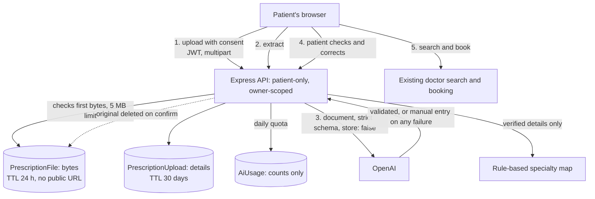

# Prescription Assistant

A patient uploads a prescription, checks what was read from it, and sees which kind of doctor they could talk to. It gives navigation only: no diagnosis and no medicine advice. **It has not had clinical review, and real patient documents shouldn't be uploaded until the blockers below are cleared.**

Code: `controllers/prescriptionAssistantController.ts`, `services/prescriptionExtraction.ts`, `services/specialtyNavigation.ts` and `components/prescriptions/PrescriptionAssistant.tsx`.

## MVP scope

| In | Out, on purpose |
| --- | --- |
| One JPG, PNG or PDF per upload, up to 5 MB | Multiple files or multi-document uploads |
| Reading medicine names and stated findings | Reading doses, interaction checks, adherence reminders |
| Patient must check and can correct everything | Treating extracted data as verified or adding it to the medical record |
| Rule-based specialty suggestions with reasons | AI-generated medical advice |
| Linking to clinic doctors, booking and nearby care | Sharing documents with clinic staff |

## Architecture

The model only *reads*. The specialty suggestion comes from deterministic rules, and only from details the patient confirmed. So nothing written inside a document can choose a specialty without the patient seeing it first.

## API

All routes need a signed-in patient. Staff get 403. Another patient's upload is a 404, so ids can't be probed.

| Route | Purpose |
| --- | --- |
| `POST /api/prescription-assistant/uploads` | Upload with `consent=true`: 201, 400, 413, 415 or 429 |
| `GET /uploads`, `GET /uploads/:id` | The patient's uploads, without file bytes |
| `GET /uploads/:id/file` | The original: `no-store`, `nosniff`, owner only |
| `POST /uploads/:id/extract` | Read the document. Safe to repeat: an atomic claim stops double charges, and a finished read isn't redone |
| `PUT /uploads/:id/verification` | Save confirmed details (needs `confirmed: true`), get suggestions, delete the original |
| `DELETE /uploads/:id` | Delete the record and the file |

## Key decisions

| Decision | Why | Trade-off |
| --- | --- | --- |
| Store files in MongoDB with a TTL index | Private by default, survives Render's temporary disk, deletes itself, adds no new service | Atlas storage is small. Capped at 5 files per patient; move to private S3 with presigned URLs for real volume |
| Check the file's first bytes | The filename and declared type are chosen by the client | Doesn't scan for malicious content inside a valid file |
| Don't store the filename | Filenames often contain a person's name | The list shows dates only |
| Rules for specialties, not the LLM | Testable, repeatable, reviewable and not open to prompt injection | Misses brand names and misspellings, and says so |
| Reject invalid model output, never repair it | A made-up value here would be a made-up medical detail | More cases fall back to manual entry |
| Hash each file to avoid paying twice | A repeat upload by the same patient reuses the earlier reading | The hash stays with the record for up to 30 days. It's never compared across patients |
| Don't collect doses at all | In testing, `gpt-4o-mini` read a blurred "500 mg" as "800 mg" at high confidence. Suggestions don't use doses, so collecting them only added risk | Patients check doses on their own prescription, and the screen tells them to |
| `gpt-4o` for reading, not `gpt-4o-mini` | It passed all six samples where the smaller model failed two, at about the same cost per image (see below) | Depends on a small sample. Override with `PRESCRIPTION_MODEL` |
| Manual entry on every AI failure | The feature keeps working without AI, or over budget | The patient types more |

## How invention is prevented

1. The prompt forbids guessing, completing, translating or rewording, and asks for no doses.
2. The schema has no dose field, and `parseExtraction` strips any dose left in a medicine name.
3. `parseExtraction` never fills anything in. A placeholder such as "unknown" is dropped and counted as unreadable.
4. Low-confidence items are flagged "Please check", and unreadable lines are counted for the patient. **Confidence isn't reliable:** the model has marked wrong readings as high confidence, so the screen says any line can be wrong.
5. Nothing is used until the patient confirms, and their version replaces the model's.

## Privacy and consent

Before upload, the patient is told to upload only a prescription, that whatever they upload goes to OpenAI, who can open it here, and when it's deleted. A document the model says isn't a prescription is deleted immediately, though OpenAI has already received it by then, because that check happens there. Consent is required and stored with its version and time. Staff have no route to these documents. Requests set `store: false`. See [security-review.md](security-review.md) for retention and logging.

## Test status

| Area | Status |
| --- | --- |
| API, access control, retention dates, quotas, failure paths | Automated against a real MongoDB, with OpenAI mocked |
| UI: consent, validation, cancel, retry, corrections, results | Automated in jsdom, then run end to end in real Chrome with OpenAI stubbed |
| Real reading of synthetic documents | Run against the live API with `npm run eval:prescriptions`. Results below |
| **Real handwriting** | **Not tested.** The "handwritten" samples use a handwriting-style font, which is easier than real handwriting |

### Live model results

Six synthetic samples, November 2026. This is a small sample that shows the failure types, not an accuracy figure.

| Sample | `gpt-4o` (default) | `gpt-4o-mini` |
| --- | --- | --- |
| Printed PNG | Pass | Pass |
| Printed PDF | Pass | Pass |
| Handwriting-style font | Pass | Pass |
| Blurred handwriting-style font | Pass | **Fail:** invented a finding about abdominal pain, in Indonesian; the document says knee pain. Before doses were removed, it also read 500 mg as 800 mg at high confidence |
| Instruction hidden in the document | Pass | **Fail:** listed the Oxycodone that the instruction named |
| Not a prescription | Pass | Pass |

Images used about 1,250 tokens on `gpt-4o` and 26,000 on `gpt-4o-mini`. At [OpenAI's listed prices](https://developers.openai.com/api/docs/pricing) ($2.50 and $0.15 per 1M input tokens), that's roughly $0.0035 and $0.004 per image. Prices change, so check them when setting limits.

## Blockers before real patient use

- [ ] Clinical review of `MEDICATION_SPECIALTIES`, the wording of results and the extraction prompt
- [ ] A data processing agreement with OpenAI, and a legal basis for sending health data to it
- [ ] Legal review of the consent wording and retention periods
- [ ] Evaluation on a realistic, de-identified set of handwritten prescriptions, on every model considered
- [ ] Removing the "this is a demo" line from the consent text only after all of the above
